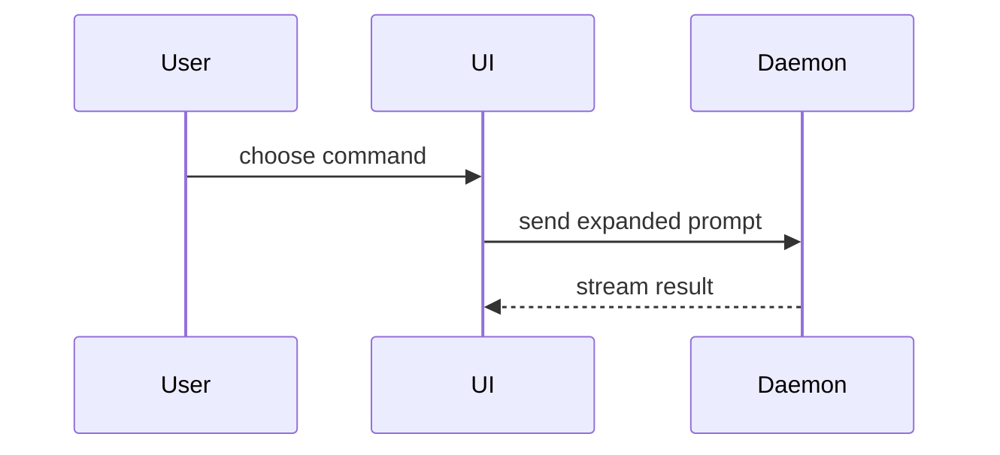

Use this template for writing the PR body:

```markdown
## Summary

<diagram, diff-sketch, or tree>

## Evidence

- **Before:** <screenshot/output/failing test run>
  **After:** <screenshot/output/passing test run>

## Review Guide

<only for a Line: a branch built from several tickets>

**Read in this order:** <files or commits, with one line each on why>

| Acceptance criterion | Test that proves it |
|---|---|

**Assumptions to check:** <every `Assumptions:` entry from the ticket files>

**QA pre-check:** <the qa agent's table from `~/.claude/lines/<branch>/qa-precheck.md`, or "not run">

## Merge Danger

**Door:** <one-way or two-way>

<optional: description>

**Blast Radius:** <one-word description>

<optional: potential ramifications of merge>
```

## Output

The deliverable is the description on the PR/MR itself, not a local file.

1. **Host** — `github.com` remote → `gh`; GitLab remote → `glab`.
2. **Push** — the branch must be on the remote at its local `HEAD`; push it (`-u`) when it is missing or behind.
3. **PR/MR exists** for the branch → replace its description: `gh pr edit --body-file <tmp>` / `glab mr update <iid> --description "$(cat <tmp>)"`. Keep the title unless the developer asks.
4. **None exists** → create it as a draft: base `develop` when the remote has it, else the default branch; title per `~/.claude/docs/git-workflow.md`; `Closes`/ticket key in the body when the tracker uses it. `gh pr create --draft --base <base> --title <t> --body-file <tmp>` / `glab mr create --draft --target-branch <base> --title <t> --description "$(cat <tmp>)"`.
5. Write the body to a temp file outside the repo (`mktemp`), never into the working tree.

Done when the PR/MR description holds every template section filled in (Review Guide only for a Line). Reply with the PR/MR URL.

## Sections

Skip all preambles and keep prose brief. Use the user's domain language from `GLOSSARY.md`/`CONTEXT.md`.

### Summary

Pick the smallest view that makes the key point clear.

- Show logic or an algorithm as pseudocode:

```text
on(save)
  if content is unchanged
    return cached result
  write new content
  return fresh result
```

- Show runtime control flow as a call tree:

```text
submitForm
  createSession
    persistPrompt
    launchAgent
  navigateToSession
```

- Show UI structure as a component tree, including state and module boundaries that matter:

```text
<SessionPage> (apps/example/src/routes/session.tsx)
  useSessionEvents()
  <SessionToolbar>
    <RunSkillButton> (packages/ui)
```

- Show file responsibility or a broad refactor as a shallow file tree:

```text
src/
├── commands/       # parses user actions
├── sessions/       # owns session state
└── transport/      # sends API requests
```

- Show component interaction, control flow, or data flow with Mermaid:



- Use `diff` when the point is what changes and the surrounding shape already exists. Match the diff shape to the topic.

For a component change:

```diff
 <SessionPage>
   useSessionEvents()
   <SessionToolbar>
+    <RunSkillButton />
   <SessionTimeline>
+    <SkillResultCard />
```

For a file-layout change:

```diff
 src/
 ├── commands/
+│   └── show-me.ts       # expands the slash command
 ├── sessions/
-└── transport.ts
+└── transport/
+    ├── client.ts
+    └── stream.ts
```

For a call-tree or call-stack change:

```diff
 submitForm
   createSession
     persistPrompt
+    expandSkillMention
     launchAgent
-  navigateToSession
+  navigateToSession
+    subscribeToEvents
```

For a state or control-flow change:

```diff
 on(save)
-  write content
+  if content is unchanged
+    return cached result
+  write new content
+  invalidate cache
```

- Show the whole block when most of it is new, when omitted context would hide ownership or order, or when the user needs a copyable target shape:

```ts
function expandSkill(command: string): string {
  const skillName = command.slice(1);
  return `use the ${skillName} skill`;
}
```

#### Guidance

Place each visual next to the short text it supports. Keep only the calls, files, props, states, and boundaries needed to answer the user's current question or the options to resolve the current discussion point.

You may use one of these, you may use several, it is unlikely you will use all of them. Use your judgement and don't overwhelm the user.

### Evidence

Concrete evidence that the change works. Show a before and after.

Screenshots are S-tier - when the environment is set up for it and the change is visual.

Execution-based evidence is A-tier. Test results, console output. Show the exact test that now fails and passes, using pseudocode.

### Review Guide

Written for the reviewer who has to understand generated code, not just approve it.

- **Reading order** — start where the domain change lives (entity, migration, domain service), then the seam it is called through, then UI. Tests next to the code they prove.
- **Acceptance criteria → test** — one row per criterion in the spec. A criterion with no test gets `⚠️ none` in the test column, not a guess.
- **Assumptions** — collect every `Assumptions:` entry from the Line's ticket files verbatim, with its ticket. These are decisions nobody approved; they matter more to the reviewer than the diff.
- **QA pre-check** — paste the qa agent's table from `~/.claude/lines/<branch>/qa-precheck.md` (branch name with `/` → `-`) as written. FAIL and BLOCKED rows stay visible.

### Merge Danger

Describe whether it's a one-way or two-way door. You can walk back through two-way doors, but not one-way doors. A PR that is cheap to roll back is lower risk. Changes that involve destructive actions or hard-to-reverse decisions are one-way doors.

The blast radius is the potential impact or scope of the changes introduced by this PR. Consider all possibilities. Examples are layout shift, breakages for consumers, mobile responsiveness, etc.
